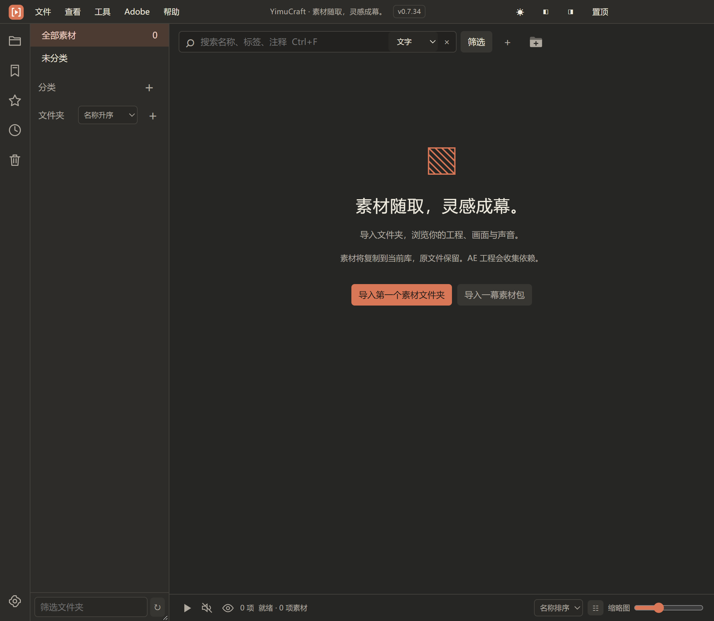

# 一幕 YimuCraft

**素材随取，灵感成幕。——蒋啊讲出品**

面向视频创作者的 Windows 本地素材管理工具，提供素材整理、媒体预览，以及 After Effects / Premiere Pro 联动。

> 当前归档：**0.7.34 开发者预览版**，标签 `v0.7.34-dev.1`。适合开发和受控试用，尚未完成完整兼容性、干净机器和用户体验验收。

[下载安装包](https://github.com/zhizhiniao/YimuCraft/releases/tag/v0.7.34-dev.1) · [使用说明](docs/USAGE.md) · [功能状态](docs/PARITY.md) · [反馈问题](https://github.com/zhizhiniao/YimuCraft/issues)



## 可以做什么

- 导入本地文件和文件夹，按分类、标签、评分与收藏整理素材。
- 预览图片、视频、音频、字体及部分设计和三维文件；支持音频波形定位。
- 复制素材入库、搜索、查重、打包导出，以及建立本地语义索引。
- 将素材发送到 AE / PR；通过自有面板收集工程及依赖。
- 连接已有素材库，使用独立索引引用原文件。

各项能力的验证范围不同。详见[功能对照表](docs/PARITY.md)，不承诺所有格式、宿主版本或原版功能完全兼容。

## 安装与开始使用

1. 在 [Releases](https://github.com/zhizhiniao/YimuCraft/releases/tag/v0.7.34-dev.1) 下载 `YimuCraft.Setup.0.7.34.exe`。
2. 将安装包放在本机磁盘后运行，按向导完成安装。
3. 打开“一幕 YimuCraft”，新建素材库或导入文件。首次安装不附带演示素材。
4. 如需 Adobe 联动，按[使用说明](docs/USAGE.md)安装对应面板。

系统目标为 Windows x64；当前仅在开发者本机验证。安装包未做代码签名。AE / PR 需要另行安装；基础素材整理不依赖 Adobe。AI 功能首次使用需要下载模型。

安装包不携带个人素材、测试库或账户配置。升级会沿用本机已有数据，不会自动清空旧库。索引备份不包含媒体文件，请自行保存原素材。

下载页同时提供 `SHA256SUMS.txt`。在 PowerShell 中运行以下命令，将结果与校验文件对照：

```powershell
Get-FileHash '.\YimuCraft.Setup.0.7.34.exe' -Algorithm SHA256
```

## 本地开发

环境：Windows x64、Git、Node.js 24.x、npm。依赖版本由 `package-lock.json` 固定。

```powershell
git clone https://github.com/zhizhiniao/YimuCraft.git
cd YimuCraft
npm ci
$env:YIMU_DATA_DIR = Join-Path $PWD 'work\dev-library'
npm start
```

私有仓库需要访问权限。`YIMU_DATA_DIR` 将开发数据与日常使用的素材库隔离。

| 命令 | 用途 |
| --- | --- |
| `npm test` | 核心逻辑测试 |
| `npm run test:ui` | 桌面冒烟测试；需要可交互桌面及 PATH 中的 FFmpeg |
| `npm run build:model` | 重建三维预览资源 |
| `npm run package` | 构建 Windows 目录版 |
| `npm run installer` | 构建 NSIS 安装包 |

Adobe 测试需要真实宿主和独立工程副本，请先阅读脚本与[交接主档](docs/HANDOFF.md)。本机测试启动参数见 `scripts/test-app.cjs`。

## 项目结构

```text
src/                  桌面应用、媒体处理和 Adobe 桥接
tests/                核心自动化测试源码
scripts/              构建、安装和验证工具
docs/                 使用说明、功能边界与维护记录
release/              本地构建产物，不提交 Git
work/                 临时测试数据，不提交 Git
```

维护入口为 [HANDOFF.md](docs/HANDOFF.md)。历史测试素材已清理，文档中的旧夹具路径不保证可用；复测时需重新生成。

## 反馈与协作

提交 Issue 时请说明版本、Windows / Adobe 版本、复现步骤、预期与实际结果，可附不含私人素材的截图。建议先用最小自有样本复现。

改动提交前先读 [AGENTS.md](AGENTS.md) 和 [贡献说明](CONTRIBUTING.md)。[发布记录](CHANGELOG.md)记录归档变化；详细技术状态只在交接主档维护。

## 授权与第三方组件

本项目暂未选择开源许可证，当前以私有开发归档维护，不授予额外的复制、修改或分发许可。第三方组件遵循各自许可证，见[第三方说明](THIRD_PARTY_NOTICES.md)。

YimuCraft 为独立实现项目，与 Adobe、Aetodo 无隶属或背书关系。仓库不包含原版程序包、专有源码和个人素材库。

## 联系作者

公众号：**知鸟PLAN** · 微信：**aizzn2030**
