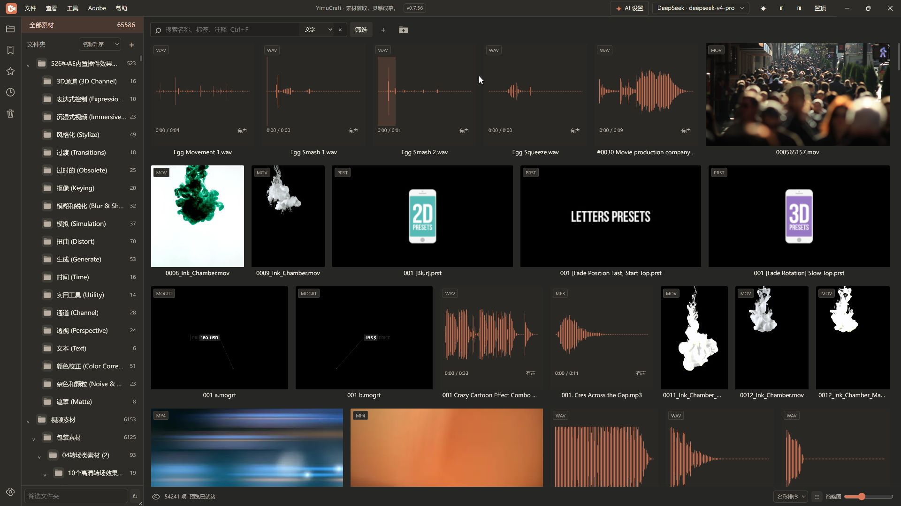
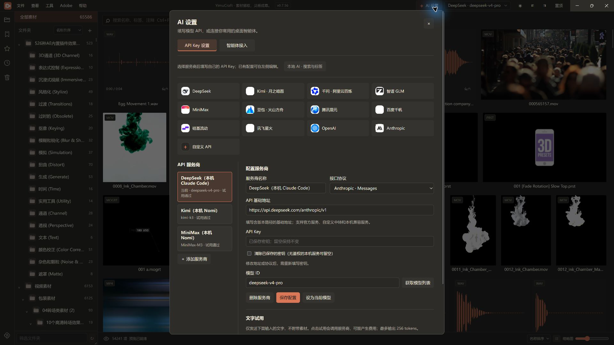
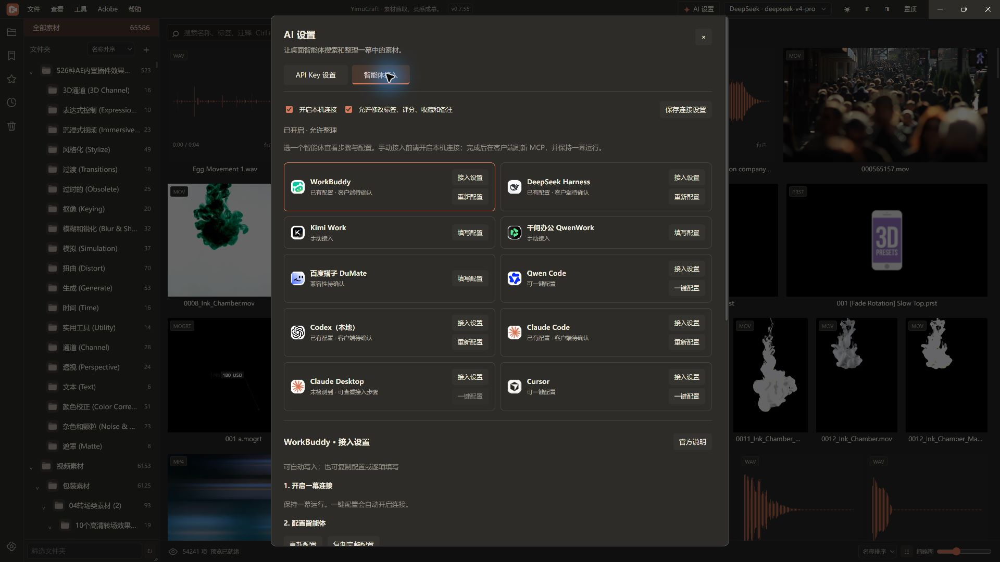
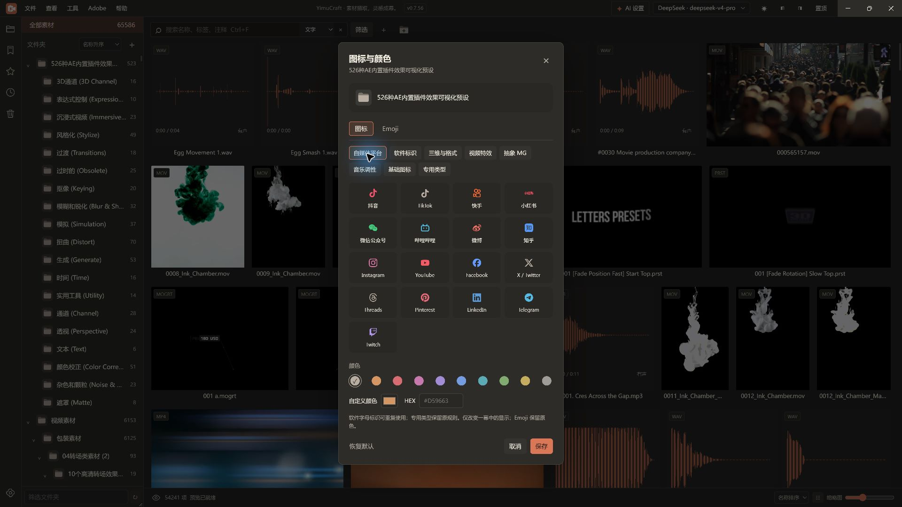
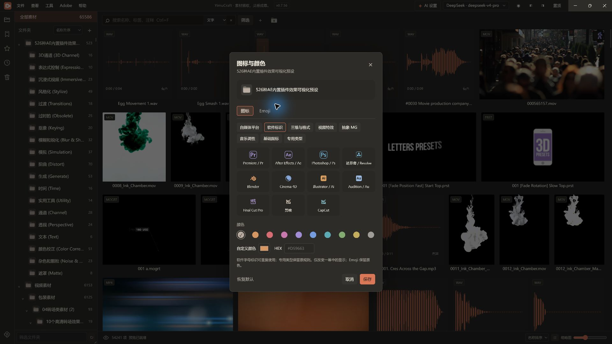

# 一幕 YimuCraft 0.7.56 · 开发者预览版

2026-10-25。将本机已使用的 0.7.56 同步到 GitHub，汇总 0.7.34 之后的本地改进。

[下载安装包](https://github.com/zhizhiniao/YimuCraft/releases/download/v0.7.56-dev.1/YimuCraft.Setup.0.7.56.exe) · [SHA-256 校验](https://github.com/zhizhiniao/YimuCraft/releases/download/v0.7.56-dev.1/SHA256SUMS.txt) · [使用说明](../USAGE.md)

## 素材浏览与预览

文件夹展开状态按素材库保存；侧栏集中展示文件夹。音频显示波形并支持点播，MOV 可生成兼容预览，AE 工程可关联或生成效果样片。



## 模型 API 设置

顶部进入“AI 设置”，选择服务商、填写自己的 API Key 与模型 ID。支持 OpenAI 兼容与 Anthropic Messages 协议，可获取模型列表、文字试用、切换当前模型。



服务商卡片是配置入口，不代表所有模型均已验证。文字试用只发送用户输入的文字，可能产生服务商费用；本地语义检索与 API 试用独立。

## 智能体接入

MCP 与鉴权本机 API 支持检索、读取、界面定位，以及经用户开启权限后的标签、评分、收藏和备注整理。统一“开启连接 → 配置客户端 → 在助手中使用”步骤。



提供 10 个客户端入口，其中 7 个支持自动配置；Kimi Work、千问办公为手动接入，百度搭子兼容性待确认。配置写入不等于宿主或模型调用通过。新连接默认只读，截图中的整理权限是本机已有设置，不是安装默认值。

## 文件夹图标与颜色

自媒体平台、软件标识、视频特效、抽象 MG、音乐调性和三维格式按组选择；支持预设色、取色器和 HEX。软件标识可重复使用，专用类型仍保留每库唯一规则。





图标用于整理和识别，不表示可以打开所有品牌的原生工程。三维卡片显示格式；OBJ、STL、GLB/glTF 与 FBX 支持范围见[功能对照表](../PARITY.md)。超过 64 MB 的主文件不进入交互查看器；复杂几何和纹理预算仍有限制。

## 修复与可靠性

- 共享封面、预览和工程依赖增加永久删除保护。
- 系统打开限制可执行类型，后台处理退出时反馈错误。
- 索引升级增加事务迁移和快照，备份可恢复到新库。
- PR 操作超时保留未决状态，人工核对后再恢复，避免直接重复发送。
- 更新品牌图标、主题化关于窗口、MOV 显示和音频兼容处理。

## 本次验证与适用范围

核心测试 108/108；全部 106 个 src 文件与现有目录版一致，安装版 ASAR 与目录版哈希一致；隔离空库启动、版本显示和查询 0 项通过。生产依赖 npm audit 返回 0 项通告，这是当次依赖检查结果，不是完整安全保证。

五张图片均由 Computer Use 从本机 0.7.56 安装版截取，没有使用界面效果图。截图素材与已配置模型属于本机环境；安装包不携带这些素材、密钥、配置或用户库。

仍为未签名 Windows x64 开发者预览版。此次没有重新安装或进行干净机器、全部 Adobe 宿主、全部智能体和全格式兼容性验收；已有功能验证边界保留在[交接主档](../HANDOFF.md)。

## 安装、升级与回退

下载安装包到本机磁盘后执行。升级沿用已有数据；安装包不附赠素材库。索引备份不包含媒体，升级前请同时保管索引和原素材。

旧 `v0.7.34-dev.1` 标签和附件保留供追溯，不保证旧版可直接读取新索引。需要回退时使用对应版本安装包与升级前备份，在独立目录验证，不覆盖当前库。

安装包 SHA-256：

```text
cb9b91a94332d7a54e79aab34c70d29dd9c64a11561845df1e133b067d035482  YimuCraft.Setup.0.7.56.exe
```
