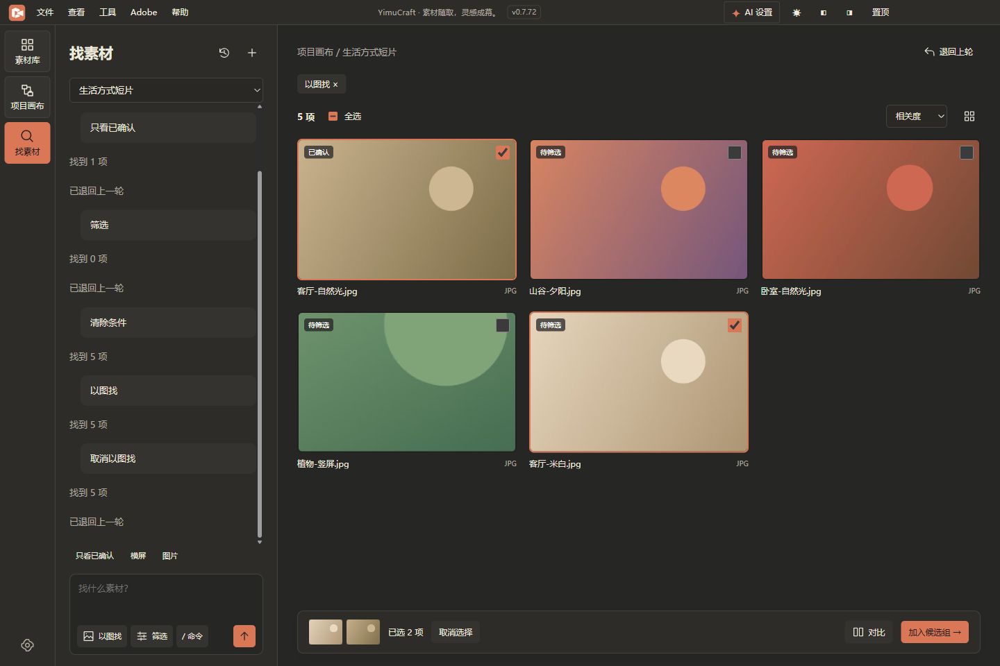

# 一幕 YimuCraft 0.7.72 · 开发者预览版

2026-11-08 · Windows x64

## 从素材到候选组

打开「项目画布 → 来源 → 打开项目仓库」并选择本地文件夹，再点左侧「找素材」。例如，先输入素材名或标签中的“客厅”，再输入“横屏”或“只看已确认”，即可逐步缩小范围。选中一张图后可以继续查找，先前的选择会保留。

需要比较画面时，勾选 2–4 项点「对比」。选好后点「加入候选组」，命名并回到画布。候选组引用原文件，原节点的位置和分组都会保留。

本版本截图来自打包应用，图中的五张测试图由脚本生成。文字查找匹配当前项目的名称、路径、标签和说明。「以图找」按颜色和布局排序，每次最多比较 500 张图片。这个入口目前只检索关联的项目仓库，尚不支持整段视频内容或自然语言画面语义检索。

## 画布与预览更新

- 从 0.7.56 安装版升级，可在项目画布中直接引用本地目录，自动发现新素材，并在重开后恢复分组、连线和布局。AE 工程扫描改为手动刷新。
- 从 0.7.63 源码升级，左侧来源栏可切换项目仓库。移除仓库会保留原文件，再次打开同一路径可以恢复编排。
- 左下角导航可定位大画布。选中多项可预览对齐、等距或网格排列，再应用或撤销。单图、多图默认在画布内移动，按住 Alt 拖动可向外部程序传递原文件。
- 媒体预览窗口支持调整尺寸、最大化、滚轮缩放与中键平移。部分无法直接播放的格式可生成本地兼容预览。

## 下载与升级

下载 [Windows x64 安装包](https://github.com/zhizhiniao/YimuCraft/releases/download/v0.7.72-dev.1/YimuCraft.Setup.0.7.72.exe) 和 [SHA-256 校验文件](https://github.com/zhizhiniao/YimuCraft/releases/download/v0.7.72-dev.1/SHA256SUMS.txt)，将安装包放到本机磁盘后运行。安装包未签名。

升级前请备份素材库索引、项目画布数据与原媒体。旧版无法识别新增的候选引用，如需回退，请在独立目录使用升级前的备份。

## 验证范围

本次重新运行核心测试，155/155 通过。用生成的图片对打包应用复测找素材，12/12 通过，覆盖筛选、对比、入组、撤销、重启和源离线。核对了全部 131 个 `src` 文件，与本机 0.7.72 安装内容逐字节一致。

验证来自开发者的 Windows 环境。干净机器安装、全部 Adobe 宿主和外部拖放接收端的兼容性仍待验证。[使用说明](https://github.com/zhizhiniao/YimuCraft/blob/v0.7.72-dev.1/docs/USAGE.md) · [功能对照表](https://github.com/zhizhiniao/YimuCraft/blob/v0.7.72-dev.1/docs/PARITY.md)
