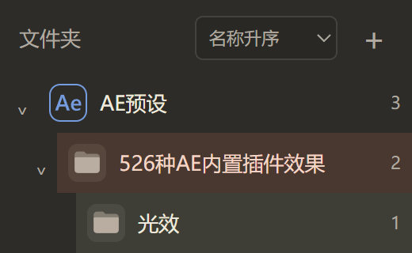

# 一幕 YimuCraft 0.7.73 · 文件夹拖拽

Windows x64 开发者预览版。可以直接用鼠标整理素材库左侧的文件夹树。

1. 按住要移动的文件夹图标或名称，拖到目标文件夹。
2. 目标行出现高亮时松手。目标会展开，原文件夹和它的子文件夹一起移入。
3. 要移回根目录，拖到列表顶部的「文件夹」标题。拖动中按 Esc 可取消。

拖放只调整一幕素材库内的层级。磁盘文件、AE 引用路径及已连接的原素材库保留原位。父级数量和「显示子文件夹内容」筛选随新层级更新，重启后保留。应用会拦截拖入自身、后代或目标已有同名文件夹的操作。

## 下载与升级

[下载 Windows x64 安装包](https://github.com/zhizhiniao/YimuCraft/releases/download/v0.7.73-dev.1/YimuCraft.Setup.0.7.73.exe) · [SHA-256 校验文件](https://github.com/zhizhiniao/YimuCraft/releases/download/v0.7.73-dev.1/SHA256SUMS.txt)

首次打开已有的一幕索引时，程序会先在索引目录的 `schema-backups` 中保存旧版快照，再升级索引。需要退回 0.7.72 时，请用旧版安装包和升级前的索引备份，在独立目录恢复。安装包未签名。

核心测试 156/156 通过。鼠标测试覆盖拖入、拖回根目录、取消、后代拦截、父级筛选和完整进程重启。截图来自隔离测试库。验证范围为开发者 Windows 环境，干净机器安装仍待验证。
