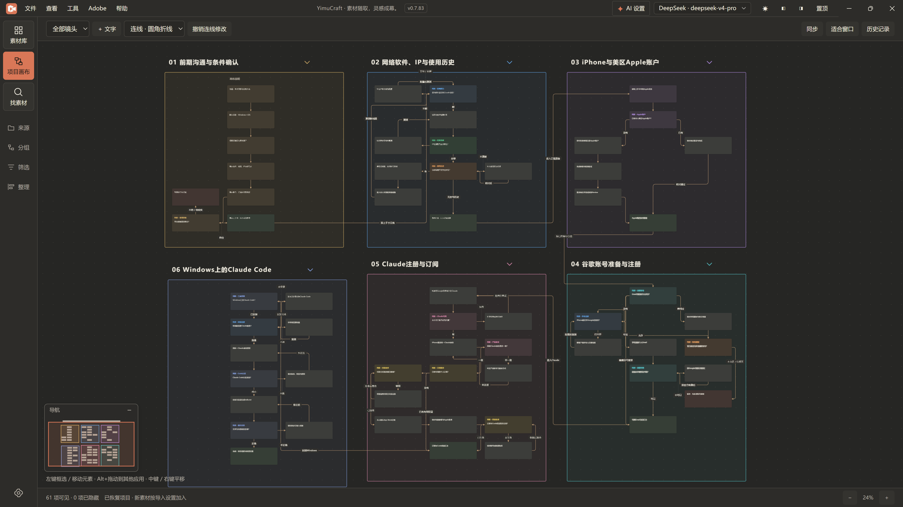

# 一幕 YimuCraft 0.7.84 · 文字框自动适合内容

**Windows x64 开发者预览版**，2026-11-16。

[下载安装包](https://github.com/zhizhiniao/YimuCraft/releases/download/v0.7.84-dev.1/YimuCraft.Setup.0.7.84.exe) · [SHA-256校验文件](https://github.com/zhizhiniao/YimuCraft/releases/download/v0.7.84-dev.1/SHA256SUMS.txt)

## 本次修复

- 文字节点按实际字体宽度自动收紧，多行按最长一行适配；输入时随增删文字调整，修改重开保留。旧文字节点默认适用，不再让短标题占用一条很长的空边框。
- 手动拉伸后保留固定尺寸。选中文字，底部“适合文字”可恢复自动适配；说明卡片与分组保持原尺寸。
- 自动尺寸文字隐藏占位滚动条，避免滚动条挤窄正文后又产生额外换行。异步尺寸回写会校验原文，并跳过已改成手动尺寸的节点。

## 修复后的文字框

下图来自0.7.84真实软件的独立验收配置，内容为当前流程图标题。正常配置中同一标题宽度由5040收紧至847，文字完整显示。

## 你提供的流程画布示例

下图由本人明确指定用于更新说明，原图未修改；截图版本为0.7.83，用于展示分组流程场景，不作为0.7.84修复后的截图。

## 验证与升级边界

核心186/186；打包版通过旧超宽多行文本、实际字形宽度、输入增删、手动尺寸保持、恢复自适应与重开。正常配置核对同图77条线/58标签、其他元素及分组/连线不变，routeBlocked/labelBlocked均0。

安装器中的EXE/ASAR与已验收包一致。安装包未签名，NSIS升级/卸载执行和干净机器安装仍未验收；升级前备份并从“文件→退出”完整退出软件及MCP连接。旧版0.7.79及更早需手动升级一次才有更新提示。
文字尺寸上限仍为8000；极长文本按上限换行/滚动，不保证无限文本尺寸。原连线避让、标签、颜色及其边界继续沿用0.7.83，本轮未改依赖或索引schema。

[完整使用说明](https://github.com/zhizhiniao/YimuCraft/blob/v0.7.84-dev.1/docs/USAGE.md) · [发布检查](https://github.com/zhizhiniao/YimuCraft/blob/v0.7.84-dev.1/docs/RELEASE-CHECK-0.7.84.md)
